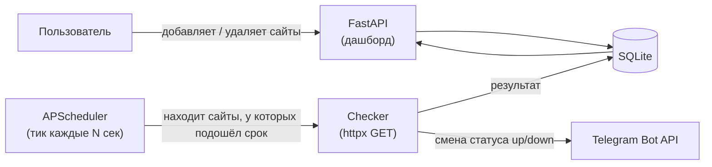
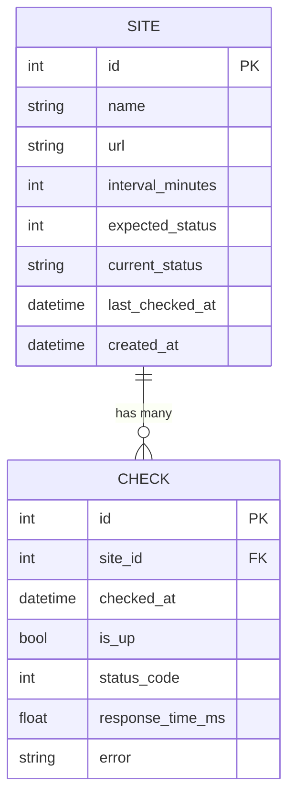

# Site Monitor

**Site Monitor** — self-hosted сервис мониторинга доступности сайтов. Проверяет указанные URL каждые N минут, ведёт историю проверок, считает аптайм и присылает уведомления в Telegram, когда сайт падает или восстанавливается.

> Стек: **FastAPI** + **APScheduler** (фоновый планировщик) + **SQLAlchemy 2.0 (async)** + **SQLite** + **httpx**. Полностью контейнеризирован (**Docker**).

---

## Возможности

- ➕ **Добавление сайта** — URL, имя, интервал проверки (минуты), опционально ожидаемый HTTP-код.
- 🗑️ **Удаление сайта** — вместе со всей историей проверок (каскадно).
- 📜 **История проверок** — время, результат (up/down), HTTP-код, время ответа, текст ошибки.
- 🔔 **Telegram-уведомления** — сообщение при падении сайта и отдельное при восстановлении (только на смену статуса, без спама).
- 📊 **Статистика аптайма** — процент доступности за 24 часа, 7 дней и за всё время + среднее время ответа.
- 🐳 **Docker** — `Dockerfile` + `docker-compose.yml`, запуск одной командой.

---

## Как это работает



Планировщик «просыпается» каждые `TICK_SECONDS` секунд, выбирает сайты, у которых `последняя проверка + интервал ≤ сейчас`, и проверяет их. Если статус изменился (был up → стал down или наоборот) — отправляется уведомление в Telegram.

---

## Структура данных



---

## Запуск

### Через Docker (рекомендуется)

```bash
cp .env.example .env   # при желании впишите Telegram-токен и chat_id
docker compose up --build
```

Дашборд: <http://localhost:8000>

### Локально

```bash
python -m venv .venv
source .venv/bin/activate        # Windows: .venv\Scripts\activate
pip install -r requirements.txt
cp .env.example .env
uvicorn app.main:app --reload
```

---

## Маршруты

| Метод | Путь | Назначение |
|-------|------|------------|
| GET | `/` | Дашборд: список сайтов + сводная статистика |
| POST | `/sites` | Добавить сайт |
| GET | `/sites/{id}` | Детали сайта: аптайм + история проверок |
| POST | `/sites/{id}/check-now` | Проверить сайт прямо сейчас |
| POST | `/sites/{id}/delete` | Удалить сайт |

---

## Переменные окружения

| Переменная | По умолчанию | Описание |
|------------|--------------|----------|
| `DATABASE_URL` | `sqlite+aiosqlite:///./data/monitor.db` | Строка подключения к БД |
| `TICK_SECONDS` | `60` | Как часто планировщик ищет проверки к выполнению |
| `DEFAULT_INTERVAL_MINUTES` | `5` | Интервал по умолчанию для новых сайтов |
| `REQUEST_TIMEOUT` | `15` | Таймаут HTTP-запроса (сек) |
| `TELEGRAM_BOT_TOKEN` | `""` | Токен бота от @BotFather (пусто = уведомления выключены) |
| `TELEGRAM_CHAT_ID` | `""` | ID чата для уведомлений (узнать через @userinfobot) |
| `LOG_LEVEL` | `INFO` | Уровень логирования |

---

## Настройка Telegram-уведомлений

1. Создайте бота через [@BotFather](https://t.me/BotFather) — получите **token**.
2. Напишите своему боту любое сообщение, затем узнайте свой **chat_id** (например, через [@userinfobot](https://t.me/userinfobot)).
3. Впишите оба значения в `.env` и перезапустите сервис.

Если переменные пусты — сервис работает как обычно, просто без отправки уведомлений (видно баннер на дашборде).

---

## Технологии

- Python 3.12, FastAPI, Uvicorn
- APScheduler (AsyncIOScheduler)
- SQLAlchemy 2.0 (async) + aiosqlite
- httpx, Jinja2, pydantic-settings
- Docker / docker-compose

## Лицензия

MIT — см. [LICENSE](LICENSE).
